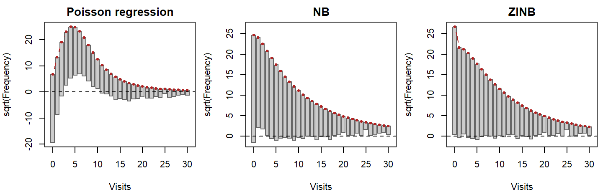
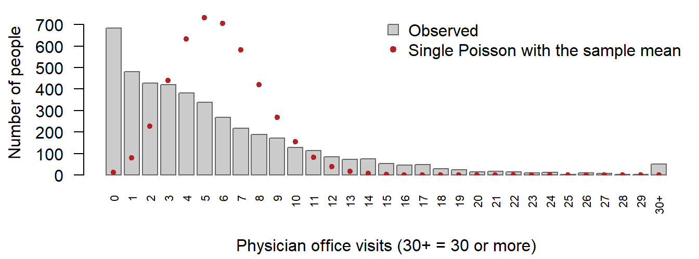
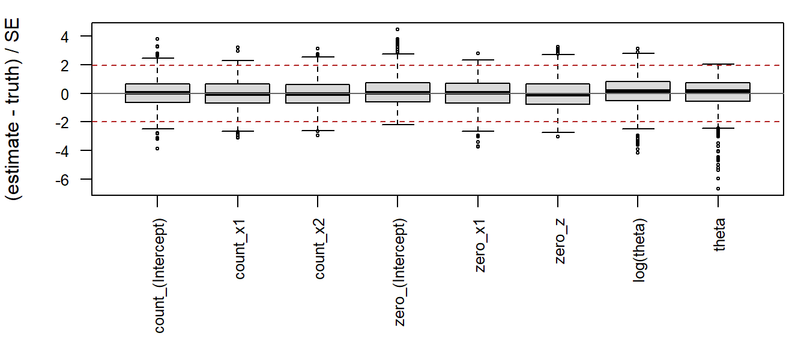

# nbzinbreg: negative binomial and zero-inflated negative binomial regression by IRLS and EM

[Download the
PDF](https://jaxsonbugg.github.io/nbzinbreg/articles/report.pdf)   For
how to use the package itself, see the [Usage
guide](https://jaxsonbugg.github.io/nbzinbreg/articles/usage.md).

## 1 Introduction

Many responses in applied work are counts: the number of doctor visits
in a year, articles published, defects on a production line. The
standard model for counts is Poisson regression, which assumes that the
variance of each count equals its mean. Real counts are usually more
spread out than that, which is called **overdispersion**, and they often
contain **more zeros** than a Poisson model allows ([Cameron and Trivedi
2013](#ref-cameron2013)). Ignoring either problem gives standard errors
that are too small and predictions that miss the zeros.

Two models address these problems. **Negative binomial (NB) regression**
adds a dispersion parameter $`\theta`$, so the variance becomes
$`\mu + \mu^2/\theta`$. The **zero-inflated negative binomial (ZINB)**
model goes further: it treats the data as a mixture of a group that
always produces zeros and a group whose counts follow an NB regression
([Lambert 1992](#ref-lambert1992)). In R, these models are usually
fitted with [`MASS::glm.nb()`](https://rdrr.io/pkg/MASS/man/glm.nb.html)
([Venables and Ripley 2002](#ref-venables2002)) and
[`pscl::zeroinfl()`](https://rdrr.io/pkg/pscl/man/zeroinfl.html)
([Zeileis et al. 2008](#ref-zeileis2008)).

This project builds an R package, **nbzinbreg**, that fits both models
without any general-purpose optimizer. The NB model is fitted by
iteratively reweighted least squares (IRLS) for the regression
coefficients, alternated with Newton–Raphson for $`\theta`$. The ZINB
model is fitted by an EM algorithm whose M-steps are IRLS fits. The
report describes the methods ([Section 2](#sec-methods)) and the package
([Section 3](#sec-package)). It then shows that the package reproduces
`glm.nb()` and `zeroinfl()` ([Section 4](#sec-benchmark)) and that
[`zinbreg()`](https://jaxsonbugg.github.io/nbzinbreg/reference/zinbreg.md)
recovers known parameters in a simulation
([Section 5](#sec-simulation)). It analyses physician visits in the
NMES1988 data ([Section 6](#sec-nmes)) and ends with a discussion of
limitations ([Section 7](#sec-discussion)).

## 2 Methods

**The NB model.** For counts $`y_i`$ with covariates $`x_i`$, an
optional offset $`o_i`$ and prior weights $`a_i`$ (1 for an ordinary
fit), the NB2 model has mean $`\mu_i = \exp(\eta_i)`$ with linear
predictor $`\eta_i = x_i^\top\beta + o_i`$, and log-likelihood

``` math
\ell(\beta, \theta) = \sum_i a_i \Big[\log\Gamma(y_i + \theta) -
\log\Gamma(\theta) - \log y_i! + \theta\log\theta + y_i\log\mu_i -
(\theta + y_i)\log(\theta + \mu_i)\Big].
 \qquad(1)
```

This is the parameterization of `glm.nb()`. As $`\theta \to \infty`$ the
model becomes the Poisson.

**IRLS for $`\beta`$ with $`\theta`$ fixed.** With $`\theta`$ held
fixed, the NB model is a generalized linear model with log link and
variance function $`V(\mu) = \mu + \mu^2/\theta`$. Fisher scoring for
such a model is the same as repeating a weighted least-squares fit, with
weights and a “working response”

``` math
w_i = a_i\,\frac{\theta\mu_i}{\theta + \mu_i}, \qquad
z_i = (\eta_i - o_i) + \frac{y_i - \mu_i}{\mu_i}, \qquad
\beta^{\text{new}} = (X^\top W X)^{-1} X^\top W z.
 \qquad(2)
```

The solution is computed from the QR decomposition of $`\sqrt{W}X`$, not
by inverting $`X^\top WX`$. A step that would lower the log-likelihood
is halved back towards the current $`\beta`$.

**Newton–Raphson for $`\theta`$ with $`\beta`$ fixed.** Write
$`U(\theta)`$ and $`H(\theta)`$ for the first and second derivatives of
[Equation 1](#eq-nb-ll) in $`\theta`$; they involve the digamma and
trigamma functions. The update works on $`\phi = \log\theta`$, which
keeps $`\theta`$ positive:

``` math
U_\phi = \theta\,U(\theta), \qquad
H_\phi = \theta^2 H(\theta) + \theta\,U(\theta), \qquad
\phi^{\text{new}} = \phi - U_\phi / H_\phi .
 \qquad(3)
```

If $`H_\phi`$ is not negative (the log-likelihood is not hill-shaped
there), a scaled uphill step is used instead, and every step must pass a
line search that guarantees an increase in the log-likelihood.

**The NB outer loop and standard errors.** The fit starts from a Poisson
IRLS fit and a moment estimate of $`\theta`$, then alternates
[Equation 2](#eq-irls) and [Equation 3](#eq-nr) until the relative
change in the log-likelihood is below $`10^{-8}`$ and the coefficients
and $`\log\theta`$ have stopped moving. As in `glm.nb()`,
$`\widehat{\operatorname{Var}}(\hat\beta) = (X^\top \hat W X)^{-1}`$,
treating $`\theta`$ as known, and
$`\operatorname{SE}(\hat\theta) = \{-H(\hat\theta)\}^{-1/2}`$.

**The ZINB model.** Each person is a *structural zero* with probability
$`\pi_i`$, with $`\operatorname{logit}\pi_i = z_i^\top\gamma`$;
otherwise the count follows the NB model above. With
$`f_0 = \{\theta/(\theta + \mu_i)\}^\theta`$ the NB probability of a
zero, the observed-data log-likelihood is

``` math
\ell(\beta, \gamma, \theta) = \sum_{y_i = 0} a_i \log\big[\pi_i + (1 -
\pi_i) f_0\big] + \sum_{y_i > 0} a_i \Big[\log(1 - \pi_i) + \log
f_{\text{NB}}(y_i; \mu_i, \theta)\Big].
 \qquad(4)
```

The first sum mixes the two sources of zeros inside a logarithm, so the
ZINB model is not a GLM and cannot be fitted by IRLS directly.

**EM.** If we knew which zeros were structural, the model would split
into two ordinary regressions. The EM algorithm ([Dempster et al.
1977](#ref-dempster1977)) treats that label as missing and alternates
two steps. The **E-step** computes, for each zero, the probability that
it is structural, given the current estimates:

``` math
\tau_i = \frac{\pi_i}{\pi_i + (1 - \pi_i) f_0} \quad (y_i = 0), \qquad
\tau_i = 0 \quad (y_i > 0).
 \qquad(5)
```

The **M-step** then fits the two regressions with these probabilities as
weights. The zero part is a logistic regression of the fractional
response $`\tau_i`$ on $`z_i`$, fitted by IRLS; each round solves
$`(Z^\top VZ)\,\Delta = Z^\top A(\tau - \pi)`$ with
$`V = \operatorname{diag}\{a_i\pi_i(1 - \pi_i)\}`$, the same
Fisher-scoring step written so that nothing is divided by
$`\pi_i(1 - \pi_i)`$, which can underflow. The count part is exactly the
NB fit above, with prior weights $`a_i(1 - \tau_i)`$, so the NB code is
reused. All of these quantities are computed on the log scale.

**Monotonicity and convergence.** EM can never lower the observed-data
log-likelihood. The package checks this at every iteration, together
with each M-step’s own objective, and a decrease (beyond rounding) is
reported and blocks convergence; the check cannot be switched off. EM
converges slowly near the maximum, so small changes alone are a poor
stopping rule: the fit stops only when the relative change in the
log-likelihood is below $`10^{-8}`$, the parameters are stable, and the
**Newton decrement** $`\delta = g^\top(-H)^{-1}g`$ (with $`g`$ and $`H`$
the gradient and Hessian of [Equation 4](#eq-zinb-ll)) is at most
$`10^{-8}`$. This establishes approximate stationarity. $`\delta`$ can
only be computed where $`-H`$ is positive definite, so a converged fit
also has negative definite curvature: a local maximum, not necessarily
the highest one.

**Standard errors for ZINB.** EM gives no standard errors. They come
from the inverse of the observed information, $`-H`$, the negative
Hessian of [Equation 4](#eq-zinb-ll) in $`(\beta, \gamma, \log\theta)`$
at the estimates. The package computes $`H`$**analytically**, from
closed-form derivatives of each observation’s contribution, and offers
[`numDeriv::hessian()`](https://rdrr.io/pkg/numDeriv/man/hessian.html)
of our own log-likelihood as an option; the two agree to about
$`10^{-11}`$. Before inverting, the Hessian is checked to be finite,
symmetric and negative definite. As in `zeroinfl()`, $`\log\theta`$ is
reported with its standard error, and $`\theta`$ with the delta-method
standard error $`\theta \cdot \operatorname{SE}(\log\theta)`$.

## 3 The R package

The package is installed from GitHub:

Code

``` r

# install.packages("devtools")
devtools::install_github("jaxsonbugg/nbzinbreg")
```

[`nbreg()`](https://jaxsonbugg.github.io/nbzinbreg/reference/nbreg.md)
and
[`zinbreg()`](https://jaxsonbugg.github.io/nbzinbreg/reference/zinbreg.md)
take `formula, data, offset, control` in that order, as the project
requires. A
[`zinbreg()`](https://jaxsonbugg.github.io/nbzinbreg/reference/zinbreg.md)
formula has the form `y ~ x1 + x2 | z1 + z2`, with the count covariates
before the bar and the zero covariates after it.
[`nbreg_control()`](https://jaxsonbugg.github.io/nbzinbreg/reference/nbreg_control.md)
and
[`zinbreg_control()`](https://jaxsonbugg.github.io/nbzinbreg/reference/zinbreg_control.md)
set the tolerances, iteration limits, tracing and the Hessian method.
Both classes have `print`, `summary`, `coef`, `vcov`, `logLik` (so
[`AIC()`](https://rdrr.io/r/stats/AIC.html) and
[`BIC()`](https://rdrr.io/r/stats/AIC.html) work), `fitted`, `residuals`
(response and Pearson), `nobs` and `predict` with `newdata` (for ZINB
the types `response`, `count`, `zero` and `prob`, with standard errors).
Beyond the requirements, the package offers
[`confint()`](https://rdrr.io/r/stats/confint.html) with a profile
interval for $`\theta`$,
[`anova()`](https://rdrr.io/r/stats/anova.html),
[`overdispersion_test()`](https://jaxsonbugg.github.io/nbzinbreg/reference/overdispersion_test.md),
[`vuong_test()`](https://jaxsonbugg.github.io/nbzinbreg/reference/vuong_test.md)
with a parametric bootstrap test of NB against ZINB,
[`expected_counts()`](https://jaxsonbugg.github.io/nbzinbreg/reference/expected_counts.md),
[`rootogram()`](https://jaxsonbugg.github.io/nbzinbreg/reference/rootogram.md),
[`simulate()`](https://rdrr.io/r/stats/simulate.html),
[`boot_se()`](https://jaxsonbugg.github.io/nbzinbreg/reference/boot_se.md),
[`tidy()`](https://generics.r-lib.org/reference/tidy.html) and
[`glance()`](https://generics.r-lib.org/reference/glance.html).

A short example, with the bioChemists data used in the project handout:

Code

``` r

library(nbzinbreg)
data("bioChemists", package = "pscl")
fit <- zinbreg(art ~ fem + mar + kid5 + phd + ment | ment,
               data = bioChemists)
round(c(coef(fit), theta = fit$theta), 3)
```

    count_(Intercept)    count_femWomen  count_marMarried        count_kid5
                0.404            -0.212             0.139            -0.168
            count_phd        count_ment  zero_(Intercept)         zero_ment
                0.002             0.024            -0.807            -0.609
                theta
                2.726 

**Design and testing.** The user-facing functions check every input and
give classed errors that say how to fix the problem; the numerical
engines never warn but return flags (for example $`\theta`$ at its
Poisson-limit bound), and the ZINB count M-step reuses the NB engine.
The tests, run on five platforms in GitHub Actions, compare both models
with `glm.nb()` and `zeroinfl()`, check offsets, single-covariate
models, bad input and the analytic Hessian, and read the package’s own
code to fail if any function calls a prohibited optimizer or fitter,
directly or indirectly.

## 4 Benchmarking

The package should reproduce
[`MASS::glm.nb()`](https://rdrr.io/pkg/MASS/man/glm.nb.html) and
`pscl::zeroinfl(dist = "negbin")`. Each model is fitted to two data sets
with both implementations:
[`pscl::bioChemists`](https://rdrr.io/pkg/pscl/man/bioChemists.html)
(915 PhD students; response `art`; `fem + mar + kid5 + phd + ment` in
the count part and, for ZINB, in the zero part, as in Appendix A of the
project description) and
[`AER::NMES1988`](https://rdrr.io/pkg/AER/man/NMES1988.html) (the models
of [Section 6](#sec-nmes)). Our functions run at their **default**
settings; the references run with **tight** tolerances
(`glm.control(epsilon = 1e-10, maxit = 100)`,
`zeroinfl.control(reltol = 1e-12)`), so that their own stopping error is
negligible. Agreement then shows that both implementations reach the
same tightly converged estimates; it does not show that these are the
global maximum of the likelihood. For every coefficient, standard error,
theta (log theta for ZINB, as `zeroinfl()` estimates it) and the
log-likelihood, the *maximum absolute difference* \|ours − reference\|
is compared with the required tolerance: 1e-5 for NB coefficients and
standard errors, 1e-4 for NB theta and log-likelihood, and 1e-3 for
every ZINB quantity.

A comparison is only meaningful if both fits are valid, so each pair is
checked first: both converged (for
[`zinbreg()`](https://jaxsonbugg.github.io/nbzinbreg/reference/zinbreg.md)
including the gradient check), every estimate and standard error is
finite, both use the same observations and parameter names, and both
covariance matrices are symmetric and positive definite. All 10 checks
passed for each of the four pairs. The side-by-side tables of every
estimate and standard error are in the appendix
([Table 6](#tbl-bench-bc-nb), [Table 7](#tbl-bench-nmes-nb),
[Table 8](#tbl-bench-bc-zinb) and [Table 9](#tbl-bench-nmes-zinb)).

[Table 1](#tbl-bench-summary) collects the maximum absolute differences
and compares them with the required tolerances.

| Data        | Model | Quantity        | Max. abs. difference | Tolerance | Met |
|:------------|:------|:----------------|---------------------:|----------:|:---:|
| bioChemists | NB    | coefficients    |              5.6e-08 |     1e-05 | yes |
| bioChemists | NB    | standard errors |              5.9e-10 |     1e-05 | yes |
| bioChemists | NB    | theta           |              2.2e-08 |     1e-04 | yes |
| bioChemists | NB    | log-likelihood  |              6.8e-13 |     1e-04 | yes |
| bioChemists | ZINB  | coefficients    |              4.8e-05 |     1e-03 | yes |
| bioChemists | ZINB  | standard errors |              2.8e-05 |     1e-03 | yes |
| bioChemists | ZINB  | log(theta)      |              4.0e-06 |     1e-03 | yes |
| bioChemists | ZINB  | log-likelihood  |              4.2e-09 |     1e-03 | yes |
| NMES1988    | NB    | coefficients    |              3.4e-07 |     1e-05 | yes |
| NMES1988    | NB    | standard errors |              9.2e-10 |     1e-05 | yes |
| NMES1988    | NB    | theta           |              7.8e-09 |     1e-04 | yes |
| NMES1988    | NB    | log-likelihood  |              1.1e-10 |     1e-04 | yes |
| NMES1988    | ZINB  | coefficients    |              1.4e-05 |     1e-03 | yes |
| NMES1988    | ZINB  | standard errors |              6.4e-06 |     1e-03 | yes |
| NMES1988    | ZINB  | log(theta)      |              2.3e-06 |     1e-03 | yes |
| NMES1988    | ZINB  | log-likelihood  |              2.6e-09 |     1e-03 | yes |

Table 1: Maximum absolute differences from the reference fits, against
the required tolerances.

Every required quantity is within its tolerance, with a large margin:
the largest differences are 3.4e-07 for the NB coefficients and 4.8e-05
for the ZINB coefficients. The NB fits agree almost to rounding error
(closely related algorithms for the same likelihood). The ZINB
differences are larger but still at least 21 times below the tolerance:
[`zinbreg()`](https://jaxsonbugg.github.io/nbzinbreg/reference/zinbreg.md)
stops when its gradient check places every estimate within a tiny
fraction of a standard error of a stationary point, `zeroinfl()` by its
own BFGS criterion. The log-likelihoods differ by at most 4.2e-09; in
all four comparisons the reference value is very slightly higher.

**Computation time** (median of 10 runs with
[`bench::mark()`](https://bench.r-lib.org/reference/mark.html);
[Table 11](#tbl-bench-time) in the appendix). The NB fits take a
fraction of a second with either implementation. Our ZINB fits are about
7 (bioChemists) and 3 (NMES1988) times slower than `zeroinfl()` at its
defaults: EM gains a roughly fixed fraction per iteration, so it needed
123 and 57 iterations of full IRLS fits, against 43 and 30 gradient
evaluations for the BFGS search of `zeroinfl()`. Further, ungraded
checks are in the supplementary benchmark article on the package
website.

## 5 Simulation study

The simulation fits
[`zinbreg()`](https://jaxsonbugg.github.io/nbzinbreg/reference/zinbreg.md)
to data generated from a ZINB model with known parameters and compares
the estimates with the truth.

**Design.** Each data set has n = 500 observations with three
covariates: x1 ~ N(0, 1), used in both parts; x2 ~ Bernoulli(0.5), used
in the count part only; and z ~ N(0, 1), used in the zero part only. The
covariates are drawn once and kept fixed (a *fixed design*); only the
responses are redrawn, so the results describe the estimator for this
design. The true model is

``` math
\log \mu_i = 1 + 0.5\,x_{1i} - 0.5\,x_{2i}, \qquad
\operatorname{logit} \pi_i = -0.8 + 0.6\,x_{1i} - 0.5\,z_i, \qquad
\theta = 1.5.
```

Each observation is a structural zero with probability $`\pi_i`$ and
otherwise a negative binomial count with mean $`\mu_i`$ and dispersion
$`\theta`$. Over this design 53.3% of the observations are expected to
be zero, and 61.9% of those zeros are structural (in the simulated data:
53.3% zeros). We simulated R = 1,000 data sets (seed 651; data set r
uses seed 651 + r, so any one of them can be reproduced alone) and
fitted each with `zinbreg(y ~ x1 + x2 | x1 + z)`, the correct model, at
its default settings.

**What is reported.** For each parameter: the **bias** (average estimate
minus the true value); the **Monte Carlo SD**, the actual spread of the
estimates; the **mean estimated SE** and its ratio to the Monte Carlo SD
(close to 1 if the standard errors are right); and the **coverage** of
the 95% Wald intervals (estimate ± 1.96 SE). Every number has a **Monte
Carlo standard error** (MC SE, in parentheses), the uncertainty left
because only R data sets were simulated: exact for averages and
coverage, and from 2,000 bootstrap resamples of the replications for the
SD and the SE ratio. Theta is reported both as log(theta), which
[`zinbreg()`](https://jaxsonbugg.github.io/nbzinbreg/reference/zinbreg.md)
estimates, and as theta, with the interval theta ± 1.96 SE(theta).
[Table 2](#tbl-sim) gives the bias, spread, standard errors and
coverage; the relative bias and RMSE ([Table 10](#tbl-sim-rmse)) and the
standardized errors ([Figure 3](#fig-sim-z)) are in the appendix.

| Parameter | Truth | Bias | MC SD | Mean SE | SE / SD | Coverage (%) |
|:---|---:|---:|---:|---:|---:|---:|
| count\_(Intercept) | 1.000 | -0.004 (0.003) | 0.103 (0.003) | 0.106 (0.0005) | 1.02 (0.03) | 94.9 (0.7) |
| count_x1 | 0.500 | -0.003 (0.002) | 0.072 (0.002) | 0.073 (0.0002) | 1.02 (0.02) | 95.3 (0.7) |
| count_x2 | -0.500 | -0.004 (0.004) | 0.126 (0.003) | 0.128 (0.0002) | 1.02 (0.02) | 95.8 (0.6) |
| zero\_(Intercept) | -0.800 | -0.048 (0.01) | 0.351 (0.02) | 0.323 (0.005) | 0.92 (0.03) | 94.7 (0.7) |
| zero_x1 | 0.600 | 0.035 (0.008) | 0.245 (0.01) | 0.226 (0.002) | 0.92 (0.03) | 95.1 (0.7) |
| zero_z | -0.500 | -0.032 (0.006) | 0.191 (0.005) | 0.181 (0.002) | 0.94 (0.02) | 95.1 (0.7) |
| log(theta) | 0.405 | 0.050 (0.009) | 0.282 (0.007) | 0.275 (0.001) | 0.98 (0.02) | 94.5 (0.7) |
| theta | 1.500 | 0.141 (0.02) | 0.478 (0.02) | 0.455 (0.005) | 0.95 (0.03) | 95.2 (0.7) |

Table 2: Simulation results over the usable replications: bias, the
spread of the estimates against the reported standard errors, and the
coverage of 95% Wald intervals (in %). Monte Carlo standard errors in
parentheses.

**Results.** Of the 1,000 fits, 1,000 were usable: converged with a
passed gradient check, no estimate on a boundary, a valid covariance
matrix, and finite, ordered intervals (none failed or ended on a
boundary). Some biases are larger than simulation noise (up to 9.3 Monte
Carlo SEs from zero, for theta), although every bias is below 31% of a
standard error. This is the small-sample bias that maximum likelihood
estimates have, of order 1/n: it is largest for the zero part and theta,
which the data determine least precisely, and it shrinks as n grows (a
check at n = 2000 is in the project notes). The reported standard errors
match the actual spread of the estimates: the SE/SD ratios lie between
0.92 and 1.02. The coverage of every 95% Wald interval is within two
Monte Carlo SEs of 95%. For theta, the interval built on the log scale
and transformed back covers 94.5% of the time, and theta ± 1.96
SE(theta) 95.2%. The estimates of theta are skewed (skewness 1.07; 0.04
for log theta), although here the theta-scale interval is closer to 95%.

The fits took a median of 0.49 s and 98 EM iterations each.
Profile-likelihood intervals for theta are summarized in the appendix.

## 6 Data analysis: NMES1988

**The data.** The NMES1988 data ([Deb and Trivedi 1997](#ref-deb1997);
[Kleiber and Zeileis 2008](#ref-kleiber2008)) come from the 1987–88 US
National Medical Expenditure Survey and describe 4,406 people aged 66
and over. The response is `visits`, the number of physician office
visits. The covariates are `hospital` (the number of hospital stays),
`health` (self-perceived health: poor, average or excellent, with
average as the reference level), `chronic` (the number of chronic
conditions), `gender`, `school` (years of education) and `insurance`
(whether the person has private insurance). Both models use all six in
the count part. The ZINB zero part uses the handout’s set, which is
every covariate except `health`; the check at the end of the model
comparison supports that choice.

**Descriptive evidence.** The mean number of visits is 5.77 and the
variance is 45.7, about 8 times the mean. A Poisson distribution has its
variance equal to its mean, so the counts are strongly *overdispersed*:
they are far more spread out than a Poisson model allows. 683 people
(15.5%) made no visits at all. As a first, rough look that ignores the
covariates, a single Poisson distribution with the sample mean would
give $`e^{-5.77}`$ = 0.31% zeros, about 14 people
([Figure 2](#fig-visits), in the appendix). That comparison exaggerates
the problem: people differ in health, and a mixture of people with
different means always has more zeros and more spread than a single mean
gives. The model comparison below accounts for the covariates.

**Model comparison.** [Table 3](#tbl-nmes-compare) compares the Poisson
regression ([`glm()`](https://rdrr.io/r/stats/glm.html)) with our NB and
ZINB fits; a model’s expected zeros are the sum over people of its
fitted probability of zero visits.

| Model                     |  df | Log-likelihood |      AIC |      BIC | Expected zeros |
|:--------------------------|----:|---------------:|---------:|---------:|---------------:|
| Poisson regression        |   8 |      -17,971.6 | 35,959.2 | 36,010.4 |           46.7 |
| NB                        |   9 |      -12,170.6 | 24,359.1 | 24,416.6 |          608.0 |
| ZINB                      |  15 |      -12,090.7 | 24,211.4 | 24,307.3 |          708.9 |
| ZINB, health in zero part |  17 |      -12,090.6 | 24,215.3 | 24,323.9 |          709.2 |

Table 3: Model comparison for NMES1988. Expected zeros: the sum over
people of each fitted model’s probability of zero visits; observed
zeros: 683. The last row adds `health` to the ZINB zero part (a
sensitivity check).

Letting each person’s mean depend on the covariates raises the Poisson
model’s expected zeros from 14 (one mean for everybody) to 47, which is
still a small fraction of the 683 observed. The Poisson model is also
far worse than the NB model in log-likelihood: the likelihood-ratio test
for overdispersion gives LR = 11,602 (p \< 1e-16; the p-value accounts
for theta = infinity being the boundary of the NB model). The NB model,
with $`\hat\theta`$ = 1.21 (95% profile interval 1.14 to 1.27), predicts
608 zeros: overdispersion alone accounts for most of the zeros, but
about 75 are still missing. The ZINB model predicts 709, about 26 too
many, a smaller error in the other direction. ZINB also has the lower
AIC (by 147.7) and, despite BIC’s larger penalty for its 6 extra
parameters, the lower BIC (by 109.3). Adding `health` to the zero part
raises the log-likelihood by only 0.08 for two more parameters, and
makes both AIC and BIC worse, so the smaller zero model is kept.

[Figure 1](#fig-rootogram) shows the fit at every count: each observed
frequency hangs from the model’s expected frequency (square-root scale),
so a bar ending below the dashed line marks a count the model
under-predicts, and one ending above it a count it over-predicts. The
Poisson model misses everywhere. The NB model has a specific pattern at
the low end: too few zeros and too many people with one or two visits
(97 and 77 too many). The ZINB model removes most of that pattern, and
its total absolute error over the counts 1 to 30 is 207, against 394 for
NB.



Figure 1: Hanging rootograms: observed frequencies (bars) hanging from
each model’s expected frequencies (red points), on a square-root scale,
for 0 to 30 visits. The NB and ZINB panels share one vertical scale; the
Poisson panel needs a wider one.

A formal test of NB against ZINB is harder than it looks, because the NB
model is the edge of the ZINB model (a zero-inflation probability of 0,
with the zero-part intercept at minus infinity), and the usual
chi-squared reference for a likelihood-ratio test does not hold on such
a boundary. The Vuong statistics ([Vuong 1989](#ref-vuong1989)), z = 5.9
(raw), 5.5 (AIC-corrected) and 4.0 (BIC-corrected), all favour ZINB, but
for the same reason they are descriptive here, not a test. In the
parametric bootstrap likelihood-ratio test, 999 data sets were simulated
from the fitted NB model, and both models were refitted to each. 32 of
them could not be refitted reliably (failed replicates). Of the 967
usable replicates, none had a likelihood-ratio statistic at least as
large as the observed LR = 159.7, which gives p = 0.001. Counting every
failed replicate as below the observed value, or as at or above it, puts
p between 0.001 and 0.033. The test is conclusive and rejects the NB
model in favour of ZINB at the 5% level.[^1]

**Interpretation.** [Table 4](#tbl-nmes-irr) gives the count-part
effects as *incidence rate ratios* (IRRs): the factor by which the
expected number of visits is multiplied per unit of a covariate (or
against the reference level of a factor), holding the others fixed; in
ZINB it describes the people “at risk” of visiting a physician.

| Covariate       |  NB IRR (95% CI)  | ZINB count IRR (95% CI) |
|:----------------|:-----------------:|:-----------------------:|
| hospital        | 1.24 (1.20, 1.29) |    1.22 (1.18, 1.27)    |
| healthpoor      | 1.36 (1.23, 1.49) |    1.33 (1.22, 1.45)    |
| healthexcellent | 0.71 (0.63, 0.80) |    0.73 (0.65, 0.82)    |
| chronic         | 1.19 (1.16, 1.22) |    1.14 (1.11, 1.16)    |
| gendermale      | 0.88 (0.83, 0.94) |    0.92 (0.87, 0.98)    |
| school          | 1.03 (1.02, 1.04) |    1.02 (1.01, 1.03)    |
| insuranceyes    | 1.25 (1.16, 1.35) |    1.13 (1.05, 1.23)    |

Table 4: Count part: incidence rate ratios with 95% Wald confidence
intervals, for the NB model and the ZINB count part.

In the ZINB model every count-part effect is clearly different from 1.
Each additional hospital stay multiplies the expected number of visits
by 1.22 (95% CI 1.18 to 1.27), about 22% more visits, and each
additional chronic condition by 1.14 (95% CI 1.11 to 1.16). Compared
with average health, poor health goes with 33% more visits and excellent
health with 27% fewer. Men make 8% fewer visits than women, each year of
education adds 2%, and private insurance 13% (intervals in
[Table 4](#tbl-nmes-irr)). The NB estimates point the same way and are
all further from 1: without a separate group of non-users, the NB model
has to fit those people’s zeros through the same covariate effects.

| Covariate    |    OR (95% CI)    | p-value |
|:-------------|:-----------------:|:-------:|
| hospital     | 0.45 (0.20, 1.02) | 0.0571  |
| chronic      | 0.29 (0.20, 0.41) | \<1e-04 |
| gendermale   | 1.91 (1.29, 2.83) | 0.0012  |
| school       | 0.92 (0.87, 0.97) | 0.0014  |
| insuranceyes | 0.31 (0.20, 0.48) | \<1e-04 |

Table 5: ZINB zero part: odds ratios of being a structural zero (a
person who would make no visits in any case), with 95% Wald confidence
intervals.

The zero part needs care in reading. It models the probability $`\pi_i`$
that a person is a **structural zero**: someone who would make no
physician office visits in any case, a “non-user”. The odds ratios in
[Table 5](#tbl-nmes-or) are therefore ratios of the odds of *belonging
to the non-user group*. They are not odds ratios of observing zero
visits. A person can also make no visits in the period while being at
risk, by chance, so the probability of an observed zero combines both
parts,
$`P(Y_i = 0) = \pi_i + (1 - \pi_i)\, f_{\mathrm{NB}}(0; \mu_i, \theta)`$,
and a covariate’s effect on it depends on both its odds ratio and its
IRR. With that in mind: each additional chronic condition multiplies the
odds of being a non-user by 0.29 (95% CI 0.20 to 0.41), and private
insurance by 0.31 (95% CI 0.20 to 0.48); men have 1.91 times the odds of
women, and each year of education multiplies them by 0.92. The
hospital-stay odds ratio is not significant at the 5% level (p = 0.06).
Chronic illness and insurance thus work in the same direction in both
parts: less likely to be a non-user and, among users, more visits. Among
users the counts stay overdispersed: $`\hat\theta`$ = 1.48 (95% Wald
interval 1.38 to 1.59, profile interval 1.39 to 1.59).

**Which model?** The Poisson model is clearly inadequate: it cannot
produce counts this spread out, and the overdispersion test rejects it
decisively. The choice between NB and ZINB rests on several pieces of
evidence that point the same way without any one being decisive alone.
Both information criteria favour ZINB, and BIC does so although it
penalizes the six extra parameters heavily. The NB model’s errors have a
systematic shape (too few zeros, too many ones and twos), which is what
a separate group of non-users would produce, and the ZINB model removes
most of it. The zero-part effects are large, mostly precisely estimated
and plausible: people with chronic conditions or private insurance are
much less likely never to see a physician. Against that, ZINB slightly
over-predicts the zeros, so it is not a perfect description either, and
its split of the zeros into structural and chance zeros depends on its
assumptions (a logistic model for the non-users and an NB distribution
for the users); the data cannot verify that split directly. The
bootstrap test agrees with this assessment. On balance we prefer the
**ZINB model**, mainly for its better fit at the low counts and its
interpretable two-part structure. All the effects are associations in a
1987–88 survey of people aged 66 and over, not causal effects, and they
need not carry over to other populations.

## 7 Discussion

Both models are fitted by IRLS, Newton–Raphson and EM without a
general-purpose optimizer, reproduce `glm.nb()` and `zeroinfl()` well
within the required tolerances ([Section 4](#sec-benchmark)), and
[`zinbreg()`](https://jaxsonbugg.github.io/nbzinbreg/reference/zinbreg.md)
recovers known parameters with accurate standard errors
([Section 5](#sec-simulation)).

**Limitations.**

- *Speed.* EM converges linearly, so
  [`zinbreg()`](https://jaxsonbugg.github.io/nbzinbreg/reference/zinbreg.md)
  is several times slower than `zeroinfl()`
  ([Section 4](#sec-benchmark)); this matters when the model is refitted
  many times, as in the bootstrap test ([Section 6](#sec-nmes)).
- *Wald intervals* rely on approximately normal estimates, which holds
  less well for the zero-part coefficients and $`\theta`$ at moderate
  sample sizes; [`confint()`](https://rdrr.io/r/stats/confint.html)
  offers a profile interval for $`\theta`$.
- *The simulation* used one design and one sample size with the correct
  model; it does not show behaviour under misspecification or weak zero
  inflation.
- *Testing NB against ZINB* is a boundary problem, so the standard
  likelihood-ratio and Vuong tests do not apply; the parametric
  bootstrap test is valid but slow, and some refits fail, which the
  package reports as bounds rather than dropping them.
- *Local maxima.* Excess zeros can be explained by zero inflation or by
  overdispersion, so the ZINB likelihood can have several maxima. The
  gradient check establishes only approximate stationarity (with the
  curvature condition, a local maximum), not the global maximum. In the
  simulation, one fit stopped at a local maximum, which confint()
  detected. Several starting values would guard against this.

**Possible extensions.** Hurdle models; EM acceleration (for example
Newton steps near the maximum with the analytic Hessian the package
already computes); sandwich standard errors; and simulations that vary
the sample size, the strength of zero inflation and the model
specification.

## 8 AI-use statement

> **Outline — to be written by the author before submission**
>
> This section must be written by the author in their own words. The
> points the project requires, and candidate examples from
> `dev/ai_use_log.md`, are listed below as a starting point; delete this
> box when the statement is written.

**Required points.**

1.  What Claude Code was asked to do (planning, implementation, tests,
    benchmark and simulation scripts, the report).
2.  What was verified independently (equations checked against the
    project description; comparisons with `glm.nb()` and `zeroinfl()`;
    tests; the prohibited-function check; reading the code).
3.  At least one concrete example where Claude’s output had to be
    corrected or rejected.

**Candidate examples from the log** (choose and describe in your own
words):

- *2026-11-08,
  [`nbreg()`](https://jaxsonbugg.github.io/nbzinbreg/reference/nbreg.md)
  plan:* Claude’s first plan clipped $`\eta`$ and floored $`\mu`$, which
  would have silently changed the likelihood; it also used the number of
  positive-weight observations instead of the sum of the weights in the
  starting value for $`\theta`$.
- *2026-11-09,
  [`zinbreg()`](https://jaxsonbugg.github.io/nbzinbreg/reference/zinbreg.md)
  validation:* with weights, `zeroinfl()` disagreed with
  [`zinbreg()`](https://jaxsonbugg.github.io/nbzinbreg/reference/zinbreg.md)
  by 0.03; instead of relaxing the tolerance, the investigation showed
  that `zeroinfl()`’s weighted fit stops at a point that is not a
  maximum.
- *2026-11-09, `grad_tol`:* the planned tolerance of $`10^{-6}`$ could
  have allowed errors above the required $`10^{-3}`$ on bioChemists, and
  was changed to $`10^{-8}`$ on that evidence.

## References

Cameron, A. Colin, and Pravin K. Trivedi. 2013. *Regression Analysis of
Count Data*. Second. Cambridge University Press.

Deb, Partha, and Pravin K. Trivedi. 1997. “Demand for Medical Care by
the Elderly: A Finite Mixture Approach.” *Journal of Applied
Econometrics* 12 (3): 313–36.

Dempster, A. P., N. M. Laird, and D. B. Rubin. 1977. “Maximum Likelihood
from Incomplete Data via the EM Algorithm.” *Journal of the Royal
Statistical Society, Series B* 39 (1): 1–38.

Kleiber, Christian, and Achim Zeileis. 2008. *Applied Econometrics with
R*. Springer-Verlag. <https://doi.org/10.1007/978-0-387-77318-6>.

Lambert, Diane. 1992. “Zero-Inflated Poisson Regression, with an
Application to Defects in Manufacturing.” *Technometrics* 34 (1): 1–14.

Venables, W. N., and B. D. Ripley. 2002. *Modern Applied Statistics with
S*. Fourth. Springer.

Vuong, Quang H. 1989. “Likelihood Ratio Tests for Model Selection and
Non-Nested Hypotheses.” *Econometrica* 57 (2): 307–33.

Zeileis, Achim, Christian Kleiber, and Simon Jackman. 2008. “Regression
Models for Count Data in R.” *Journal of Statistical Software* 27 (8):
1–25. <https://doi.org/10.18637/jss.v027.i08>.

## Appendix

Detailed tables and records that support the main text: the side-by-side
benchmark comparisons ([Section 4](#sec-benchmark)), the relative bias
and RMSE from the simulation ([Section 5](#sec-simulation)) and its
standardized errors, the computation times, the distribution of visits
in NMES1988, the profile-likelihood intervals in the simulation, and the
provenance of the saved results.

| Parameter | Ours | Reference | \|Diff.\| | SE ours | SE ref. | SE \|diff.\| |
|:---|---:|---:|---:|---:|---:|---:|
| (Intercept) | 0.256144 | 0.256144 | 5.6e-08 | 0.1373477 | 0.1373477 | 5.9e-10 |
| femWomen | -0.2164184 | -0.2164184 | 1.2e-08 | 0.07263609 | 0.07263609 | 1.9e-10 |
| marMarried | 0.1504894 | 0.1504895 | 7.5e-09 | 0.08209654 | 0.08209654 | 2.9e-10 |
| kid5 | -0.1764152 | -0.1764152 | 1.3e-08 | 0.0528133 | 0.0528133 | 4.5e-11 |
| phd | 0.01527116 | 0.01527116 | 1.4e-09 | 0.03587299 | 0.03587299 | 1.0e-10 |
| ment | 0.02908235 | 0.02908234 | 4.9e-09 | 0.003214319 | 0.003214319 | 4.4e-11 |
| theta | 2.264388 | 2.264388 | 2.2e-08 | 0.2711764 | 0.2711753 | 1.1e-06 |
| log-likelihood | -1560.958 | -1560.958 | 6.8e-13 |  |  |  |

Table 6: bioChemists, negative binomial: nbreg() against glm.nb().

| Parameter | Ours | Reference | \|Diff.\| | SE ours | SE ref. | SE \|diff.\| |
|:---|---:|---:|---:|---:|---:|---:|
| (Intercept) | 0.9292563 | 0.9292566 | 3.4e-07 | 0.05459127 | 0.05459127 | 8.1e-10 |
| hospital | 0.2177724 | 0.2177722 | 1.9e-07 | 0.02017649 | 0.02017649 | 3.4e-10 |
| healthpoor | 0.3050132 | 0.305013 | 2.0e-07 | 0.0485108 | 0.0485108 | 4.5e-10 |
| healthexcellent | -0.3418066 | -0.3418066 | 5.0e-08 | 0.06092362 | 0.06092362 | 9.2e-10 |
| chronic | 0.1749156 | 0.1749155 | 9.3e-08 | 0.01209175 | 0.01209175 | 3.7e-12 |
| gendermale | -0.1264882 | -0.1264881 | 2.8e-08 | 0.03121552 | 0.03121552 | 2.5e-10 |
| school | 0.02681508 | 0.02681508 | 5.2e-09 | 0.004393971 | 0.004393971 | 4.0e-11 |
| insuranceyes | 0.2244019 | 0.2244019 | 8.0e-08 | 0.03946374 | 0.03946374 | 4.5e-10 |
| theta | 1.206604 | 1.206604 | 7.8e-09 | 0.03355513 | 0.03355471 | 4.2e-07 |
| log-likelihood | -12170.55 | -12170.55 | 1.1e-10 |  |  |  |

Table 7: NMES1988, negative binomial: nbreg() against glm.nb().

| Parameter | Ours | Reference | \|Diff.\| | SE ours | SE ref. | SE \|diff.\| |
|:---|---:|---:|---:|---:|---:|---:|
| count\_(Intercept) | 0.4167473 | 0.4167465 | 7.7e-07 | 0.1435962 | 0.1435966 | 3.3e-07 |
| count_femWomen | -0.1955061 | -0.1955068 | 7.2e-07 | 0.07559252 | 0.07559256 | 4.0e-08 |
| count_marMarried | 0.09758305 | 0.09758263 | 4.2e-07 | 0.08445195 | 0.08445195 | 8.7e-09 |
| count_kid5 | -0.1517319 | -0.1517325 | 5.3e-07 | 0.05420606 | 0.05420606 | 2.5e-09 |
| count_phd | -0.0006999403 | -0.0007001341 | 1.9e-07 | 0.03626958 | 0.03626966 | 7.9e-08 |
| count_ment | 0.0247861 | 0.0247862 | 9.7e-08 | 0.003492425 | 0.003492673 | 2.5e-07 |
| zero\_(Intercept) | -0.1917344 | -0.1916883 | 4.6e-05 | 1.32279 | 1.322819 | 2.8e-05 |
| zero_femWomen | 0.6359367 | 0.6359332 | 3.5e-06 | 0.8488967 | 0.8489176 | 2.1e-05 |
| zero_marMarried | -1.499421 | -1.499468 | 4.8e-05 | 0.9386443 | 0.9386706 | 2.6e-05 |
| zero_kid5 | 0.6284206 | 0.6284272 | 6.6e-06 | 0.4427749 | 0.4427826 | 7.7e-06 |
| zero_phd | -0.03770477 | -0.03771474 | 1.0e-05 | 0.3080017 | 0.3080082 | 6.5e-06 |
| zero_ment | -0.8822694 | -0.8822932 | 2.4e-05 | 0.3162164 | 0.3162281 | 1.2e-05 |
| log(theta) | 0.9763605 | 0.9763565 | 4.0e-06 | 0.1354682 | 0.1354695 | 1.2e-06 |
| log-likelihood | -1549.991 | -1549.991 | 4.2e-09 |  |  |  |

Table 8: bioChemists, zero-inflated negative binomial: zinbreg() against
zeroinfl(). count\_ and zero\_ name the count and zero-part
coefficients.

| Parameter | Ours | Reference | \|Diff.\| | SE ours | SE ref. | SE \|diff.\| |
|:---|---:|---:|---:|---:|---:|---:|
| count\_(Intercept) | 1.193714 | 1.193713 | 1.6e-06 | 0.05666106 | 0.05666094 | 1.2e-07 |
| count_hospital | 0.2014768 | 0.2014769 | 2.7e-08 | 0.02035972 | 0.02035972 | 2.0e-10 |
| count_healthpoor | 0.285133 | 0.2851329 | 6.6e-08 | 0.04509263 | 0.04509265 | 1.9e-08 |
| count_healthexcellent | -0.3193364 | -0.3193365 | 1.2e-07 | 0.06040493 | 0.06040494 | 1.2e-08 |
| count_chronic | 0.1289994 | 0.1289997 | 2.7e-07 | 0.01193052 | 0.01193052 | 1.4e-09 |
| count_gendermale | -0.08027684 | -0.08027716 | 3.2e-07 | 0.03102401 | 0.03102403 | 2.1e-08 |
| count_school | 0.02142348 | 0.02142347 | 1.3e-08 | 0.004357589 | 0.00435757 | 1.9e-08 |
| count_insuranceyes | 0.1258629 | 0.1258637 | 7.7e-07 | 0.04158759 | 0.0415876 | 1.4e-08 |
| zero\_(Intercept) | -0.04688547 | -0.04687855 | 6.9e-06 | 0.2685599 | 0.268558 | 1.9e-06 |
| zero_hospital | -0.8004752 | -0.8004833 | 8.1e-06 | 0.4208095 | 0.4208159 | 6.4e-06 |
| zero_chronic | -1.247925 | -1.247938 | 1.4e-05 | 0.1783134 | 0.1783161 | 2.7e-06 |
| zero_gendermale | 0.6476771 | 0.6476784 | 1.3e-06 | 0.2001131 | 0.2001148 | 1.7e-06 |
| zero_school | -0.08376964 | -0.08377058 | 9.4e-07 | 0.02625341 | 0.02625282 | 6.0e-07 |
| zero_insuranceyes | -1.175611 | -1.175615 | 4.4e-06 | 0.2201179 | 0.2201209 | 3.0e-06 |
| log(theta) | 0.3941454 | 0.394143 | 2.3e-06 | 0.0350351 | 0.03503503 | 7.2e-08 |
| log-likelihood | -12090.72 | -12090.72 | 2.6e-09 |  |  |  |

Table 9: NMES1988, zero-inflated negative binomial: zinbreg() against
zeroinfl().

| Parameter          |  Relative bias |          RMSE |
|:-------------------|---------------:|--------------:|
| count\_(Intercept) | -0.004 (0.003) | 0.103 (0.003) |
| count_x1           | -0.005 (0.005) | 0.072 (0.002) |
| count_x2           |  0.008 (0.008) | 0.126 (0.003) |
| zero\_(Intercept)  |   0.060 (0.01) |  0.354 (0.02) |
| zero_x1            |   0.058 (0.01) |  0.248 (0.01) |
| zero_z             |   0.065 (0.01) | 0.194 (0.006) |
| log(theta)         |   0.123 (0.02) | 0.286 (0.007) |
| theta              |   0.094 (0.01) |  0.498 (0.02) |

Table 10: Relative bias and root mean squared error (RMSE) of each
estimate, with Monte Carlo standard errors (bootstrap over the
replications).

| Data        | Model | Fit                           | Median (s) |        Range (s) |
|:------------|:------|:------------------------------|-----------:|-----------------:|
| bioChemists | NB    | nbreg() (default settings)    |     0.0238 | 0.0214 to 0.0285 |
| bioChemists | NB    | glm.nb() (tight settings)     |     0.0403 | 0.0364 to 0.0715 |
| bioChemists | NB    | glm.nb() (default settings)   |     0.0307 | 0.0291 to 0.0328 |
| bioChemists | ZINB  | zinbreg() (default settings)  |       1.12 |     1.09 to 1.17 |
| bioChemists | ZINB  | zeroinfl() (tight settings)   |      0.152 |   0.147 to 0.157 |
| bioChemists | ZINB  | zeroinfl() (default settings) |      0.156 |   0.149 to 0.216 |
| NMES1988    | NB    | nbreg() (default settings)    |     0.0905 |  0.0833 to 0.096 |
| NMES1988    | NB    | glm.nb() (tight settings)     |      0.129 |   0.122 to 0.192 |
| NMES1988    | NB    | glm.nb() (default settings)   |     0.0999 |  0.0943 to 0.112 |
| NMES1988    | ZINB  | zinbreg() (default settings)  |       2.35 |      2.29 to 2.4 |
| NMES1988    | ZINB  | zeroinfl() (tight settings)   |      0.692 |   0.677 to 0.759 |
| NMES1988    | ZINB  | zeroinfl() (default settings) |      0.698 |   0.691 to 0.777 |

Table 11: Computation time in seconds (median of 10 runs, with the
minimum and maximum).

### Profile-likelihood intervals in the simulation

The profile-likelihood interval for theta from
[`confint()`](https://rdrr.io/r/stats/confint.html) was computed for the
first 200 data sets: 199 were finite, 0 unbounded above (certified), and
1 could not be evaluated. Its coverage over the 199 evaluable intervals
is 93.5% (MC SE 1.8%); counting the others as not covering or covering
gives 93.0% to 93.5%. In one case (data set 86),
[`confint()`](https://rdrr.io/r/stats/confint.html) refused to give an
interval because its search over theta found a higher likelihood than
the fit:
[`zinbreg()`](https://jaxsonbugg.github.io/nbzinbreg/reference/zinbreg.md)
had converged, with its gradient check passed, to a local maximum.
Excess zeros can be explained either by zero inflation or by
overdispersion, and the ZINB likelihood can have a maximum for each; EM
finds the one its starting values lead to. The other fits passed the
same checks, which establish a local maximum but not the highest one, so
a small share of them may also be lower local maxima.

### Provenance of the saved results

The timings, the simulation and the NMES1988 bootstrap are read from
saved results, because they take minutes to hours to produce. Each was
produced from a clean, committed state of the package, and each is
checked here against the installed code.

**Timings.** The timings were measured on Windows 10 x64 (Intel64 Family
6 Model 186 Stepping 2, GenuineIntel, 20 cores) under R version 4.3.1
(2023-06-16 ucrt), with MASS 7.3.60, pscl 1.5.9 and bench 1.1.4, on
2026-11-10, for the package code of commit 65f2720 (code fingerprint
f6f29a27eff95d07ab6302d5a428954e; provenance verified). The installed
package’s code fingerprint (f6f29a27eff95d07ab6302d5a428954e) matches
the code that produced the timings (commit
65f2720b0fc178074ae477c7b23d55ba54768b71).

**Simulation.** The results were produced at commit 445d9d3 (code
fingerprint f6f29a27eff95d07ab6302d5a428954e; provenance verified) under
R version 4.3.1 (2023-06-16 ucrt). The installed package’s code
fingerprint (f6f29a27eff95d07ab6302d5a428954e) matches the code that
produced the simulation results (commit
445d9d3d16dd6c07cd077ae772e08ae8cb1ed442).

**NMES1988 bootstrap.** The bootstrap results were produced at commit
c3ec075 (code fingerprint f6f29a27eff95d07ab6302d5a428954e; provenance
verified) under R version 4.3.1 (2023-06-16 ucrt). The installed
package’s code fingerprint (f6f29a27eff95d07ab6302d5a428954e) matches
the code that produced the bootstrap results (commit
c3ec0757dd51cf26b71033d4b3e8853503113418).



Figure 2: Observed frequencies of physician office visits (bars) and the
frequencies a single Poisson distribution with the sample mean would
give (points). The single Poisson ignores the covariates; it is a
descriptive reference only.



Figure 3: Standardized errors (estimate − truth) / SE for each parameter
over the usable replications. If the estimates are approximately normal
and the standard errors are right, about 95% of them lie between the
dashed lines at ±1.96.

[^1]: The refits used the EM iteration limit maxit = 20000, chosen
    before the full run by a fixed rule that looks only at the share of
    failed replicates in 50-replicate pilots: 6.0% at the default maxit
    = 5000 and 4.0% at maxit = 20000; the lower share wins, the default
    on a tie.
