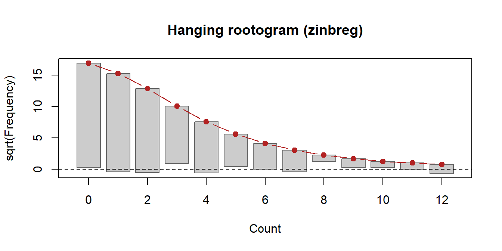

# Using nbzinbreg

This guide walks through the package with a small, real data set. Every
output below is produced by the installed package when this page is
built.

## Installation

``` r

# install.packages("devtools")
devtools::install_github("jaxsonbugg/nbzinbreg")
```

``` r

library(nbzinbreg)
```

## The Data

The examples use `bioChemists` from the pscl package: the number of
articles (`art`) published by 915 biochemistry PhD students in the last
three years of their PhD, with gender (`fem`), marital status (`mar`),
the number of children under 6 (`kid5`), the prestige of the PhD
programme (`phd`) and the number of articles by the student’s mentor
(`ment`).

``` r

data("bioChemists", package = "pscl")
c(mean = mean(bioChemists$art), variance = var(bioChemists$art),
  zeros = mean(bioChemists$art == 0))
```

         mean  variance     zeros
    1.6928962 3.7097416 0.3005464 

The variance is more than twice the mean (overdispersion), which a
Poisson model cannot describe.

## Negative Binomial Regression

[`nbreg()`](https://jaxsonbugg.github.io/nbzinbreg/reference/nbreg.md)
takes a formula and a data frame, like
[`glm()`](https://rdrr.io/r/stats/glm.html). The coefficients are on the
log scale of the expected count; `theta` is the dispersion parameter,
with variance $`\mu + \mu^2/\theta`$.

``` r

fit_nb <- nbreg(art ~ fem + mar + kid5 + phd + ment, data = bioChemists)
summary(fit_nb)
```

    Call:
    nbreg(formula = art ~ fem + mar + kid5 + phd + ment, data = bioChemists)

    Pearson residuals:
        Min      1Q  Median      3Q     Max
    -1.2677 -0.8754 -0.2613  0.4983  6.6573

    Coefficients:
                 Estimate Std. Error z value Pr(>|z|)
    (Intercept)  0.256144   0.137348   1.865 0.062191 .
    femWomen    -0.216418   0.072636  -2.979 0.002887 **
    marMarried   0.150489   0.082097   1.833 0.066791 .
    kid5        -0.176415   0.052813  -3.340 0.000837 ***
    phd          0.015271   0.035873   0.426 0.670326
    ment         0.029082   0.003214   9.048  < 2e-16 ***
    ---
    Signif. codes:  0 '***' 0.001 '**' 0.01 '*' 0.05 '.' 0.1 ' ' 1

    Theta: 2.264 (SE 0.2712)
    Log-likelihood: -1560.96 on 7 df
    AIC: 3135.92;  BIC: 3169.65
    Observations: 915;  residual df: 909
    Outer passes: 4;  converged: yes

`exp(coef(fit_nb))` gives incidence rate ratios: the factor by which the
expected count changes per unit of a covariate.

``` r

round(exp(coef(fit_nb)), 3)
```

    (Intercept)    femWomen  marMarried        kid5         phd        ment
          1.292       0.805       1.162       0.838       1.015       1.030 

## Zero-Inflated Negative Binomial Regression

[`zinbreg()`](https://jaxsonbugg.github.io/nbzinbreg/reference/zinbreg.md)
adds a second, logistic model for the probability of a *structural zero*
(a student who would publish nothing in any case). The formula has two
parts: count covariates before `|`, zero covariates after. Without `|`,
both parts use the same covariates.

``` r

fit_zi <- zinbreg(art ~ fem + mar + kid5 + phd + ment | ment,
                  data = bioChemists)
summary(fit_zi)
```

    Call:
    zinbreg(formula = art ~ fem + mar + kid5 + phd + ment | ment,
        data = bioChemists)

    Pearson residuals:
        Min      1Q  Median      3Q     Max
    -1.3041 -0.7685 -0.2632  0.4671  6.3765

    Count model coefficients (negative binomial with log link):
                 Estimate Std. Error z value Pr(>|z|)
    (Intercept)  0.404007   0.141715   2.851  0.00436 **
    femWomen    -0.211906   0.071922  -2.946  0.00322 **
    marMarried   0.139462   0.081192   1.718  0.08586 .
    kid5        -0.167624   0.052457  -3.195  0.00140 **
    phd          0.001963   0.035586   0.055  0.95602
    ment         0.024393   0.003518   6.934 4.08e-12 ***
    Log(theta)   1.002896   0.142830   7.022 2.19e-12 ***
    ---
    Signif. codes:  0 '***' 0.001 '**' 0.01 '*' 0.05 '.' 0.1 ' ' 1

    Zero-inflation model coefficients (binomial with logit link):
                Estimate Std. Error z value Pr(>|z|)
    (Intercept)  -0.8067     0.3532  -2.284   0.0224 *
    ment         -0.6095     0.2458  -2.480   0.0131 *
    ---
    Signif. codes:  0 '***' 0.001 '**' 0.01 '*' 0.05 '.' 0.1 ' ' 1

    Theta: 2.726 (SE 0.3894)
    Log-likelihood: -1553.27 on 9 df
    AIC: 3124.54;  BIC: 3167.91
    Observations: 915;  residual df: 906
    EM iterations: 126;  converged: yes
    Gradient check: Newton decrement 9.35e-09 (grad_tol 1e-08)
    Starting values: count part from negative binomial fit; zero part from logistic fit of I(y == 0)

The summary also reports how the fit converged: the number of EM
iterations and the gradient check at the estimates.

## Comparing the Models

[`logLik()`](https://rdrr.io/r/stats/logLik.html) carries the number of
parameters, so [`AIC()`](https://rdrr.io/r/stats/AIC.html) and
[`BIC()`](https://rdrr.io/r/stats/AIC.html) work directly.

``` r

c(AIC_nb = AIC(fit_nb), AIC_zinb = AIC(fit_zi),
  BIC_nb = BIC(fit_nb), BIC_zinb = BIC(fit_zi))
```

      AIC_nb AIC_zinb   BIC_nb BIC_zinb
    3135.917 3124.542 3169.649 3167.913 

[`overdispersion_test()`](https://jaxsonbugg.github.io/nbzinbreg/reference/overdispersion_test.md)
tests the Poisson model against NB, and
[`vuong_test()`](https://jaxsonbugg.github.io/nbzinbreg/reference/vuong_test.md)
compares the ZINB and NB fits. Because NB is the boundary of ZINB, the
Vuong statistics are descriptive; `vuong_test(B = 199)` adds a
parametric bootstrap test (it refits both models for every replicate, so
it takes a while).

``` r

overdispersion_test(fit_nb)
```

        Likelihood-ratio test for overdispersion (Poisson against negative
        binomial; boundary-corrected p-value)

    data:  art ~ fem + mar + kid5 + phd + ment
    LR = 180.2, p-value < 2.2e-16
    alternative hypothesis: true theta is less than Inf
    sample estimates:
       theta
    2.264388 

``` r

vuong_test(fit_zi, fit_nb)
```

    Vuong comparison: model 1 (zinbreg) vs model 2 (nbreg), N = 915

                  z statistic Favours p-value
    Raw                1.8805 model 1 0.03002
    AIC-corrected      1.3912 model 1 0.08208
    BIC-corrected      0.2124 model 1 0.41590

    Note: the NB model is the boundary pi = 0 of the zero-inflated model, so the
    Vuong test is not a valid test of zero inflation; the statistics are descriptive.

## Predictions

[`predict()`](https://rdrr.io/r/stats/predict.html) gives the expected
count, and for ZINB also the count-part mean, the probability of a
structural zero, or the probability of each count. It accepts `newdata`,
and `se.fit = TRUE` adds delta-method standard errors.

``` r

new <- data.frame(fem = c("Men", "Women"), mar = "Married", kid5 = 0,
                  phd = 3, ment = 10)
predict(fit_zi, newdata = new, type = "response")
```

           1        2
    2.208425 1.786705 

``` r

predict(fit_zi, newdata = new, type = "zero")
```

              1           2
    0.001005186 0.001005186 

``` r

round(predict(fit_zi, newdata = new, type = "prob")[, 1:4], 3)
```

          0     1     2     3
    1 0.199 0.242 0.202 0.142
    2 0.254 0.273 0.201 0.126

## Confidence Intervals

[`confint()`](https://rdrr.io/r/stats/confint.html) gives Wald intervals
for the coefficients and a profile-likelihood interval for theta.

``` r

confint(fit_nb)
```

                   2.5 %   97.5 %
    (Intercept) -0.01305  0.52534
    femWomen    -0.35878 -0.07405
    marMarried  -0.01042  0.31140
    kid5        -0.27993 -0.07290
    phd         -0.05504  0.08558
    ment         0.02278  0.03538
    theta        1.80734  2.89853

## Diagnostics

[`expected_counts()`](https://jaxsonbugg.github.io/nbzinbreg/reference/expected_counts.md)
compares observed and expected frequencies of each count, and
[`rootogram()`](https://jaxsonbugg.github.io/nbzinbreg/reference/rootogram.md)
draws them as a hanging rootogram: bars that end below the dashed line
are counts the model under-predicts.

``` r

head(expected_counts(fit_zi), 5)
```

      count observed  expected
    1     0      275 286.38330
    2     1      246 233.06538
    3     2      178 165.24942
    4     3       84 101.24471
    5     4       67  57.74262

``` r

rootogram(fit_zi, max_count = 12)
```



## Control Settings

[`nbreg_control()`](https://jaxsonbugg.github.io/nbzinbreg/reference/nbreg_control.md)
and
[`zinbreg_control()`](https://jaxsonbugg.github.io/nbzinbreg/reference/zinbreg_control.md)
set tolerances and iteration limits, and `trace = TRUE` prints the
progress of the fit. For ZINB, `hessian = "numeric"` uses a numerical
Hessian for the standard errors instead of the analytic one.

``` r

fit_zi_num <- zinbreg(art ~ fem + mar + kid5 + phd + ment | ment,
                      data = bioChemists,
                      control = zinbreg_control(hessian = "numeric"))
max(abs(sqrt(diag(vcov(fit_zi_num))) - sqrt(diag(vcov(fit_zi)))))
```

    [1] 6.236107e-09

## Tidy Summaries

[`tidy()`](https://generics.r-lib.org/reference/tidy.html) and
[`glance()`](https://generics.r-lib.org/reference/glance.html) return
the coefficient table and the model summary as data frames.

``` r

head(tidy(fit_zi), 4)
```

             term component   estimate  std.error statistic     p.value
    1 (Intercept)     count  0.4040069 0.14171517  2.850837 0.004360426
    2    femWomen     count -0.2119064 0.07192227 -2.946326 0.003215732
    3  marMarried     count  0.1394620 0.08119249  1.717671 0.085856667
    4        kid5     count -0.1676240 0.05245733 -3.195436 0.001396197

``` r

glance(fit_zi)
```

         logLik      AIC      BIC    theta SE.theta nobs df df.residual iter
    1 -1553.271 3124.542 3167.913 2.726166 0.389377  915  9         906  126
      converged newton_decrement
    1      TRUE     9.354037e-09

## Where Next

- The
  [Reference](https://jaxsonbugg.github.io/nbzinbreg/reference/index.md)
  lists every function with its arguments and examples.
- The
  [Report](https://jaxsonbugg.github.io/nbzinbreg/articles/report.md)
  explains the algorithms and shows the benchmarks against `glm.nb()`
  and `zeroinfl()`, a simulation study and an analysis of the NMES1988
  data.
